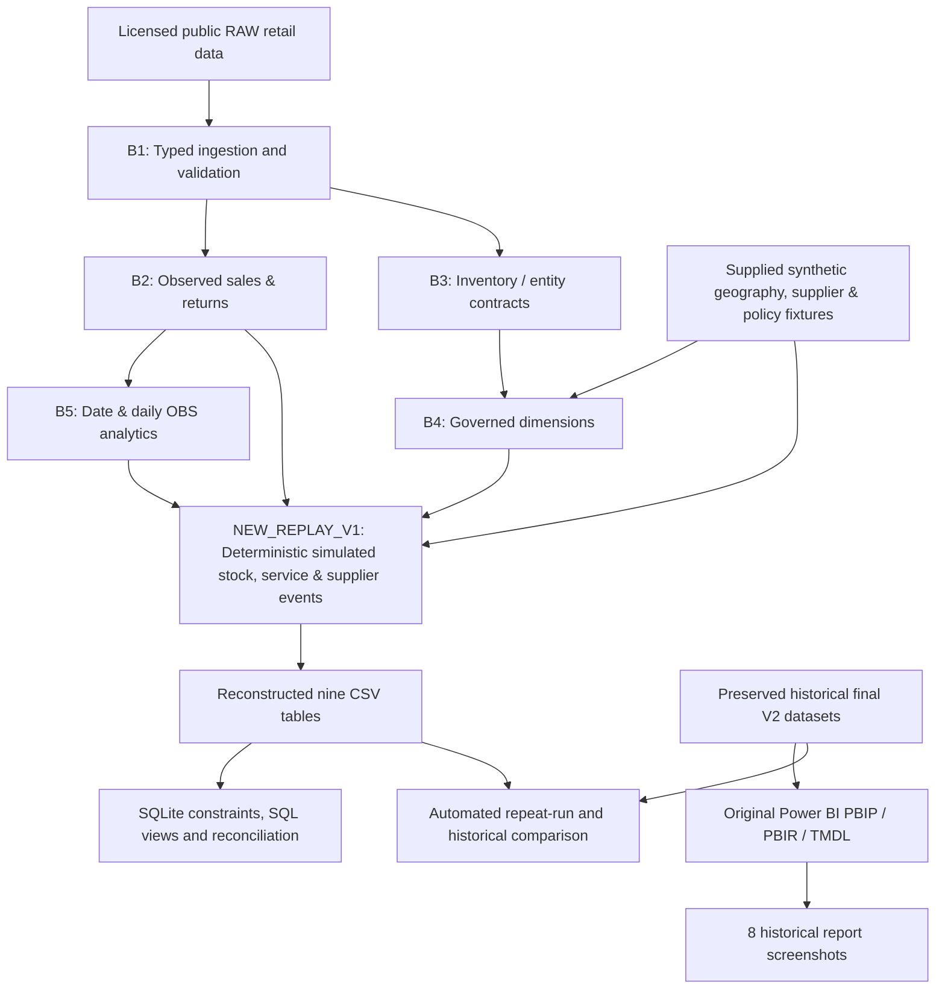

# Enterprise Retail Warehouse & Inventory Intelligence

### From open retail data to governed warehouse analytics, inventory simulation and an 8-page Power BI report

[](https://github.com/khaledzidan203-stack/enterprise-retail-warehouse-inventory-intelligence/actions/workflows/ci.yml)


[](DATA_SOURCES.md)

**A portfolio implementation of multi-store inventory and distribution-center intelligence.** The repository combines licensed public retail sales/inventory data, governed analytical datasets, a preserved Power BI semantic model, Python transformations, an executable SQLite analytical layer and explicit simulation/validation evidence.

**Start here:** [Case Study](docs/CASE_STUDY.md) · [Dashboard Gallery](#power-bi-dashboard-gallery) · [Eight-page Guide](docs/REPORT_PAGE_GUIDE.md) · [Power BI Quick Start](#quick-start-open-the-original-power-bi-report) · [Technical Walkthrough](docs/TECHNICAL_WALKTHROUGH.md) · [Evidence Map](docs/PROJECT_EVIDENCE_MAP.md) · [Release Validation](docs/FINAL_RELEASE_VALIDATION.md) · [Project Index](docs/PROJECT_INDEX.md)

[](DASHBORD_SCREEN_SHOTS/2_Executive%20Overview.png)

> **Two distinct deliverables:** the **original historical V2 Power BI report and its nine datasets** are included and preserved. The reconstructed **`NEW_REPLAY_V1` Python/SQLite simulation** is executable and deterministic, but intentionally **does not reproduce all historical simulated values**. Screenshots show the historical report, not the new replay or fictional sample. Power BI Desktop opening and refresh have **not yet been verified on another machine**.

## Business case and deliverables

The project answers warehouse and retail stock questions across **three deliberately different grains**: Store × Product inventory positions, Date × Store observed demand/modeled service, and cumulative Supplier × Distribution Center simulated procurement. The [Case Study](docs/CASE_STUDY.md) explains the business problem, historical results, assumptions and decision-support boundaries. Technical reviewers can trace each claim in the [Evidence Map](docs/PROJECT_EVIDENCE_MAP.md) and run the [Python/SQLite walkthrough](docs/TECHNICAL_WALKTHROUGH.md).

## Project at a glance

| Scope | Verified repository artifact / baseline |
|:---|:---|
| Reporting | **8 Power BI pages · 112 visuals · 51 explicit DAX measures · 18 relationships** |
| Report assets | Complete `.pbip` + PBIR/TMDL semantic/report definitions + **8 authentic screenshots** |
| Model | **5 dimensions + 4 fact tables**; nine CSV imports with a single configurable `DataRoot` |
| Retail source | **125,751 sales rows · 284,755 inventory interval rows** |
| Entities | **40 stores · 2,326 products**; **4 synthetic distribution centers · 30 suppliers** in the enriched model |
| Observation horizon | **2025-06-01 to 2026-04-24**, with report snapshot **2026-04-24** |
| Engineering | Python 3.11+ · standard-library CSV/Decimal · SQLite SQL · automated regression/reconciliation checks |
| Source rights | **Mendeley Data, CC BY 4.0**; original two RAW CSV SHA-256 hashes matched the publisher |

The geographical assignments, supplier operating parameters, ABC classification and replenishment policies are supplied **synthetic/modeling inputs**, not operational facts about real distribution centers.

## Power BI dashboard gallery

**All eight screenshots are from the existing historical Power BI report.** Select any image to view it at full resolution; each page is retained as a native PBIR page in the [Power BI project](powerbi/Enterprise%20Retail%20Inventory%20Intelligence.pbip). See the [Illustrated Eight-page Guide](docs/REPORT_PAGE_GUIDE.md) for its questions, intended grain and interpretation limits.

| Dashboard page | Dashboard page |
|:---|:---|
| **01 · INDEX** | **02 · Executive Overview** |
| [](DASHBORD_SCREEN_SHOTS/1_INDEX.png) | [](DASHBORD_SCREEN_SHOTS/2_Executive%20Overview.png) |
| Navigate the eight-page report | View the preserved historical dashboard |
| **03 · Store Inventory Intelligence** | **04 · DC Inventory Intelligence** |
| [](DASHBORD_SCREEN_SHOTS/3_Store%20Inventory%20Intelligence.png) | [](DASHBORD_SCREEN_SHOTS/4_DC%20Inventory%20Intelligence.png) |
| Review Store × SKU inventory and demand | Analyze DC × SKU stock and policy comparisons |
| **05 · Sales & Stockout Performance** | **06 · Supplier Execution Simulation** |
| [](DASHBORD_SCREEN_SHOTS/5_Sales%20%26%20Stockout%20Performance.png) | [](DASHBORD_SCREEN_SHOTS/6_Supplier%20Execution%20Simulation.png) |
| Distinguish observed demand from simulated shortage | Review simulated purchasing and receipt cohorts |
| **07 · Inventory Opportunities** | **08 · Data Quality & Methodology** |
| [.png)](DASHBORD_SCREEN_SHOTS/7_Inventory%20Opportunities%20(Exploratory).png) | [](DASHBORD_SCREEN_SHOTS/8_Data%20Quality%20%26%20Methodology.png) |
| Inspect zero-demand and opportunity flags | Review model definitions, boundaries and checks |

**Reporting questions:** Where is inventory concentrated across stores and DCs? What does observed customer demand look like? How does the *historical simulated* service and supplier execution scenario behave? Which zero-demand stocks warrant exploratory review? How are the figures governed and validated?

## Quick start: open the original Power BI report

**Requirements:** Git, Python 3.11+ and a compatible **Power BI Desktop** installation on Windows. The original historical CSV inputs are already included, so **you do not need to rerun the simulation to open the preserved report**.

```powershell
git clone https://github.com/khaledzidan203-stack/enterprise-retail-warehouse-inventory-intelligence.git
cd enterprise-retail-warehouse-inventory-intelligence

# Verify all nine historical report CSVs (read-only)
python configure_powerbi.py --check

# Close Power BI Desktop, then set DataRoot for this computer
python configure_powerbi.py
```

Open **[Enterprise Retail Inventory Intelligence.pbip](powerbi/Enterprise%20Retail%20Inventory%20Intelligence.pbip)** in Power BI Desktop and refresh the nine import tables. The configuration script points `DataRoot` to the cloned repository's historical `data/` folder, not to a generated `build/` directory. It verifies the historical CSV hashes; it **does not** modify the source CSVs or execute a simulation.

For manual parameter configuration, troubleshooting and the report acceptance checklist, see **[Power BI setup](docs/powerbi_setup.md)**. Static model and import checks passed; actual Desktop refresh, measure evaluation and interactive page behavior remain **POWER_BI_RUNTIME_NOT_VERIFIED**.

## Historical report baseline

The values below belong to the **preserved historical final V2 scenario** at `2026-04-24`. They are not claimed as results of `NEW_REPLAY_V1`.

| Metric | Historical result | Provenance / interpretation |
|:---|---:|:---|
| Store × Product snapshot rows | **50,447** | Historical reporting universe |
| DC × Product snapshot rows | **9,304** | Synthetic DC scenario |
| Date × Store daily service rows | **12,706** | OBS demand/returns + SIM service |
| Supplier × DC execution rows | **120** | Simulated supplier cohorts |
| Store ending on-hand | **68,734 units** | Historical **SIM** stock |
| DC ending on-hand | **53,030 units** | Historical **SIM** stock |
| Full-history customer returns | **7,547 units** | **OBS** signed-return inflow |
| Evaluation-window gross demand | **30,000 units** | **OBS** gross positive demand |
| Evaluation-window fulfilled | **29,363 units** | Historical **SIM** fulfillment |
| Evaluation-window shortage | **637 units** | Historical **SIM** unmet demand |
| 84-day zero-positive-sale stock | **45,021 units** | OBS window classification × historical SIM stock |
| 84-day zero-positive-sale Store × Product pairs | **31,776** | Historical reporting universe |

Evaluation window: **2026-02-02 to 2026-04-24**. This previously reused development window is **not** an independent out-of-sample certification. **Simulated shortage is not an observed stockout or proven lost sale.** Opportunity classifications are exploratory decision-support signals, not approved replenishment instructions.

## Analytical architecture

The repository preserves **two separate paths**. They share source contracts and some governed fixtures, but the existing historical presentation must **not** be mistaken for the new replay output.



**Analytical grains:** Date × Store × Product for observed movements; Date × Store for daily demand/service; Store × Product and DC × Product at the reporting snapshot; Supplier × DC for historical execution cohorts. The five shared reporting dimensions define stable entity/date filtering.

| Evidence type | What it means here |
|:---|:---|
| **OBS — Observed** | Retail source rows, typed attributes, positive gross demand and customer return inflow |
| **SIM — Simulated** | Opening/closing physical stock, stock transfers, purchase orders, fulfillment, shortage, modeled supplier behavior |
| **EXP — Exploratory** | Zero-demand inventory and opportunity flags; policy not approved for operational automation |

## Run the analytical code

### Option A — fast fictional sample (independent and repeatable)

The demo uses newly generated **fictional source data**; it is not the historical report.

```powershell
python run_pipeline.py --sample --output-dir build/sample_one
python run_pipeline.py --sample --output-dir build/sample_two
python validate.py --mode public --build build/sample_one --compare-build build/sample_two
```

Each execution writes nine analytical CSVs, `analytics.sqlite`, machine-readable `execution.json` and reconciliation/event evidence into its **new** `build/<run-name>` directory. Existing run directories are protected against overwriting. SQLite executes **[real analytical SQL](src/sql/analytics.sql)** for constraints, dimensional projections and KPI/data-quality views.

### Option B — full included open-data source, new simulation

```powershell
python run_pipeline.py --input-dir data/raw --reference-dir data/synthetic --policy config/store_replenishment_policy_v2.json --output-dir build/replay_one
python run_pipeline.py --input-dir data/raw --reference-dir data/synthetic --policy config/store_replenishment_policy_v2.json --output-dir build/replay_two
python validate.py --mode private --build build/replay_one --compare-build build/replay_two --baseline-root .
```

The legacy `--mode private` argument denotes the original-reference comparison, **not private data in this published repository**. It is expected to exit **2** due to transparent **historical SIM differences**; a zero exit is not promised. The full-source replay produces **63,556 Store × Product rows** rather than the historical **50,447**, primarily because inventory-only pairs are retained. Other differences in opening balances, allocations and supplier behavior are documented in the [methodology](docs/methodology.md).

**Start with Option A** for a quick executable tour. **Use the Power BI quick start** to view the completed report with its actual preserved historical results. Do not point the original report at `build/` without deliberately opting into the new scenario.

## Validation and reproducibility status

| What was checked | Verified status |
|:---|:---|
| Existing B1–B5 observed transformations and five dimensions | **PASS** against the retained references |
| New scenario: arithmetic, conservation, SQLite constraints, SQL projections and deterministic repeat-run | **PASS** in the recorded local execution |
| Previously executed project test suite | **55/55 PASS** (local evidence) |
| Previously executed isolated fresh-clone sample tests | **47/47 PASS** (local evidence) |
| GitHub Actions | **Runs publication checks plus two executable fictional-sample pipelines and public validation**; inspect the [live GitHub Actions](https://github.com/khaledzidan203-stack/enterprise-retail-warehouse-inventory-intelligence/actions). Does not certify Power BI Desktop runtime |
| Historical V2 simulation ↔ `NEW_REPLAY_V1` exact equivalence | **NOT MET**; differences documented, not hidden |
| Actual Power BI Desktop open / refresh / rendered interaction testing | **NOT VERIFIED** |

**Overall status: `PARTIAL_REPRODUCIBILITY`.** The source code and new scenario can be executed and checked independently; the included historical presentation is preserved, but reconstructing its original simulation event history is not claimed. In particular, differences in scenario stock balances and simulated service are **not** software validation failures concealed as a success.

For exact historical-vs-replay comparisons, see [Methodology & reconciliation](docs/methodology.md). For definitions, table schemas, relationship grains and executed SQL, see [Analytical dictionary](docs/analytics_dictionary.md). GitHub CI runs integrity checks **and the reproducible Python/SQLite fictional sample** in [`ci.yml`](.github/workflows/ci.yml), but **does not** execute Power BI Desktop.

## Repository guide

| Location | Contents |
|:---|:---|
| [`data/raw/`](data/raw/) | Two original, hash-verified public Mendeley CSVs |
| [`data/synthetic/`](data/synthetic/) & [`config/`](config/) | Supplied geography/operating fixtures and governed simulation policies |
| [`data/analytics_v1/`](data/analytics_v1/) & [`data/powerbi_model_v1/`](data/powerbi_model_v1/) | **Historical final V2 reporting outputs** under retained presentation schema names |
| [`src/python/`](src/python/) | Canonical ingestion, observed analytics, dimensions, replay, SQL integration and tests |
| [`src/sql/analytics.sql`](src/sql/analytics.sql) | Executable SQLite schema, constraints and analytical SQL views |
| [`powerbi/`](powerbi/) | Original PBIP/PBIR/TMDL report, model, measures and relationships |
| [`DASHBORD_SCREEN_SHOTS/`](DASHBORD_SCREEN_SHOTS/) | All eight authentic historical Power BI screenshots |
| [`docs/`](docs/) | KPI dictionary, methodology, Power BI setup and publication boundaries |
| [`release_manifest.json`](release_manifest.json) · [`prepare_release.py`](prepare_release.py) | Explicit publication allowlist, immutable asset hashes and integrity checks |

## Portfolio documentation and reviewer paths

| Entry point | Why open it |
|:---|:---|
| [Case Study](docs/CASE_STUDY.md) | Business problem, historical network outcomes and analytic design choices |
| [Illustrated Report Page Guide](docs/REPORT_PAGE_GUIDE.md) | All eight authentic screenshots explained page-by-page |
| [Technical Walkthrough](docs/TECHNICAL_WALKTHROUGH.md) | RAW → Python → simulation → SQLite → Power BI and runnable commands |
| [Evidence Map](docs/PROJECT_EVIDENCE_MAP.md) | Every major technical claim linked to an actual artifact and its verification boundary |
| [Final Release Validation](docs/FINAL_RELEASE_VALIDATION.md) | Real test results, current CI scope and unverified Desktop acceptance |
| [Project Index](docs/PROJECT_INDEX.md) | One-page navigation for employers, BI reviewers and engineers |

## Data provenance, attribution and usage boundaries

**Source:** Smith, Jimmy (2026), *Retail Transactions and Stocks Data*, Mendeley Data, Version 1. **DOI: [10.17632/27x8mjm8k4.1](https://doi.org/10.17632/27x8mjm8k4.1)**. The two published RAW files are included unchanged, and their size/SHA-256 identities were checked against publisher metadata before release.

**Source data license:** [CC BY 4.0](https://creativecommons.org/licenses/by/4.0/). Credit the source author and identify adaptations when redistributing derived materials. The published source is **not** a record of real supplier SLA performance or the synthetic warehouse network. Full attribution and hashes: [DATA_SOURCES.md](DATA_SOURCES.md); distribution details: [docs/release_rights.md](docs/release_rights.md).

**Code licensing is separate:** the source-data CC BY license does **not** automatically grant a license to this repository's authored software or dashboard assets. No general-purpose software license is asserted in this repository.

---

**Portfolio focus:** reproducible data engineering, governed dimensional modeling, inventory analytics, simulated supply-chain execution, SQL/Python reconciliation and a complete source-controlled Power BI report.