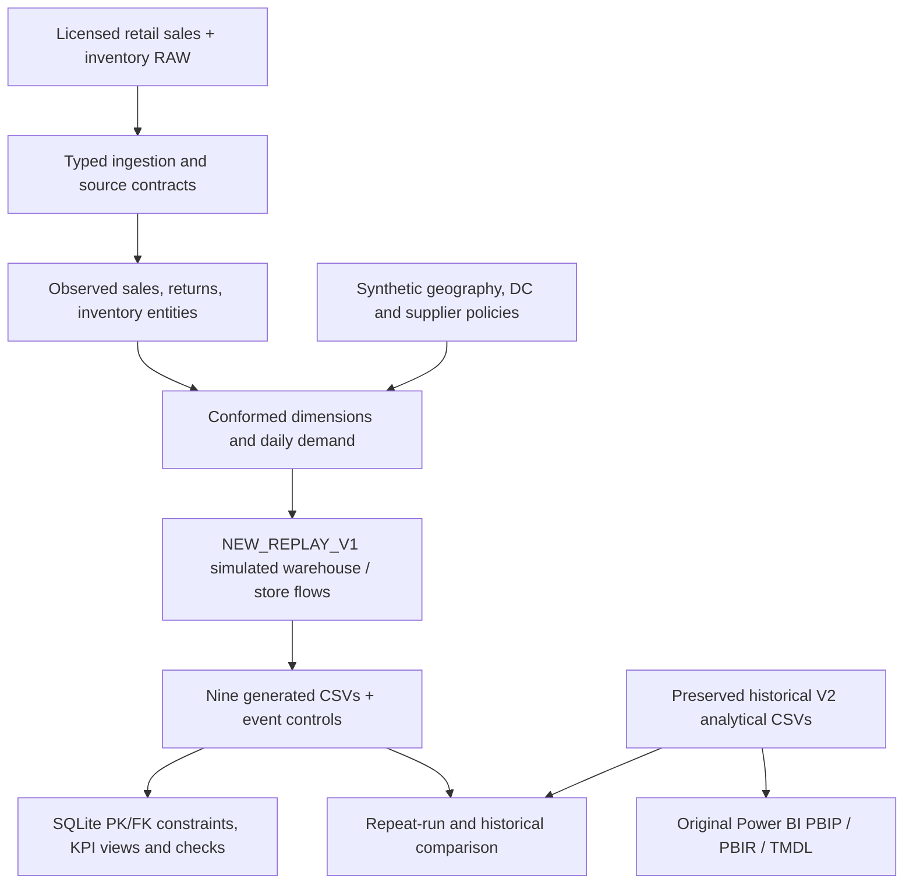

# Enterprise Retail Warehouse & Inventory Intelligence

**Open retail data → Python & SQLite analytics → simulated warehouse operations → eight-page Power BI report**

[](https://github.com/khaledzidan203-stack/enterprise-retail-warehouse-inventory-intelligence/actions)


[](DATA_SOURCES.md)

[](DASHBORD_SCREEN_SHOTS/2_Executive%20Overview.png)

**A completed, source-controlled analytics case study** connecting retail transactions to inventory visibility, distribution-center positions, supplier execution scenarios and decision-support reporting. The public repository includes real licensed source data, the original historical analytical outputs, a native Power BI project, and a separately runnable Python/SQLite simulation.

[**Case Study**](docs/CASE_STUDY.md) · [**8-page Gallery**](#power-bi-dashboard-gallery) · [**Open Power BI**](#open-the-original-power-bi-report) · [**Technical Walkthrough**](docs/TECHNICAL_WALKTHROUGH.md) · [**Evidence Map**](docs/PROJECT_EVIDENCE_MAP.md) · [**Validation**](docs/FINAL_RELEASE_VALIDATION.md)

## At a glance

| Business and engineering scope | Published deliverable |
|:---|:---|
| Reporting | **8 Power BI pages · 112 visuals · 51 DAX measures · 18 relationships** |
| Dimensional model | **5 dimensions + 4 fact tables**, native PBIP/PBIR/TMDL |
| Source data | **125,751 sales rows · 284,755 inventory interval rows**, verified against Mendeley V1 |
| Analytical entities | **40 stores · 2,326 products**; scenario enriched with **4 synthetic DCs and 30 suppliers** |
| Time scope | **2025-06-01–2026-04-24**, historical report as of **2026-04-24** |
| Engineering | Python, executable SQLite SQL, simulated replenishment/supplier events, validation and GitHub Actions |
| Dashboard evidence | **8 authentic screenshots**, original model definitions and nine historical CSV inputs |

## What business questions does it address?

The report connects several decision-support perspectives **without confusing their grains**:

- **Store inventory:** which Store × Product positions hold simulated physical stock, in-transit inventory or open replenishment requests?
- **Distribution centers:** how do modeled DC stock, on-order quantities and store backlog compare with frozen *simulation* thresholds?
- **Demand and service:** how does **observed** positive customer demand compare with **simulated** fulfillment and shortage?
- **Supplier execution:** how do cumulative modeled purchase orders, receipts, cancellations and outstanding quantities reconcile?
- **Inventory opportunity screening:** where does inventory exist with no recent observed demand, without declaring an unapproved overstock or return decision?

[Read the business case and scope →](docs/CASE_STUDY.md)

## Power BI dashboard gallery

All images are **captures of the retained historical Power BI report**, not mock-ups or outputs of the reconstructed simulation. Click to open each screenshot in full resolution. The [illustrated page guide](docs/REPORT_PAGE_GUIDE.md) documents each page's metrics and analytical boundaries.

| Page | Page |
|:---|:---|
| **01 · INDEX** | **02 · Executive Overview** |
| [](DASHBORD_SCREEN_SHOTS/1_INDEX.png) | [](DASHBORD_SCREEN_SHOTS/2_Executive%20Overview.png) |
| Seven report destinations | Network stock and modelled service |
| **03 · Store Inventory** | **04 · DC Inventory** |
| [](DASHBORD_SCREEN_SHOTS/3_Store%20Inventory%20Intelligence.png) | [](DASHBORD_SCREEN_SHOTS/4_DC%20Inventory%20Intelligence.png) |
| Store × SKU stock and flows | Distribution center positions |
| **05 · Demand & Service** | **06 · Supplier Execution** |
| [](DASHBORD_SCREEN_SHOTS/5_Sales%20%26%20Stockout%20Performance.png) | [](DASHBORD_SCREEN_SHOTS/6_Supplier%20Execution%20Simulation.png) |
| Observed demand, modelled shortage | Simulated orders, receipts and open lines |
| **07 · Inventory Opportunities** | **08 · Quality & Methodology** |
| [.png)](DASHBORD_SCREEN_SHOTS/7_Inventory%20Opportunities%20(Exploratory).png) | [](DASHBORD_SCREEN_SHOTS/8_Data%20Quality%20%26%20Methodology.png) |
| Exploratory zero-demand stock | Evidence, boundaries and methods |

**Native report:** [Power BI project (PBIP/PBIR/TMDL)](powerbi/Enterprise%20Retail%20Inventory%20Intelligence.pbip) · [Semantic model](powerbi/) · [Page-by-page guide](docs/REPORT_PAGE_GUIDE.md).

## Historical reporting snapshot

These are outcomes from the **preserved historical final V2 simulation**. They are *not* presented as direct measurement of physical warehouse stock or as results regenerated by the newer replay engine.

| KPI / grain | Historical V2 | Source meaning |
|:---|---:|:---|
| Store × Product rows | **50,447** | Historical reporting universe |
| DC × Product rows | **9,304** | Modeled distribution-center inventory |
| Date × Store rows | **12,706** | Observed demand/returns + simulated service |
| Store closing on-hand | **68,734 units** | Historical SIM |
| DC closing on-hand | **53,030 units** | Historical SIM |
| Full-history customer returns | **7,547 units** | Observed source movements |
| Evaluation-window demand | **30,000 units** | Observed gross positive demand |
| Evaluation-window fulfilled / shortage | **29,363 / 637 units** | Historical SIM |

The evaluation window is **2026-02-02–2026-04-24** and was reused during development; it is not independent out-of-sample validation. Modeled shortage does not prove observed lost sales.

## Analytical architecture



**OBS** = source-observed demand/returns; **SIM** = modeled inventory/service/supplier activity; **EXP** = diagnostic opportunity signals, not approved action policies. Source/attribute contracts, valid aggregation grains and all limitations are described in the [technical walkthrough](docs/TECHNICAL_WALKTHROUGH.md) and [methodology](docs/methodology.md).

## Open the original Power BI report

**Requirements:** Git, Python 3.11+, and compatible Power BI Desktop on Windows. Historical report CSVs are **already included**; no simulation run is required.

```powershell
git clone https://github.com/khaledzidan203-stack/enterprise-retail-warehouse-inventory-intelligence.git
cd enterprise-retail-warehouse-inventory-intelligence

python configure_powerbi.py --check
# Close Power BI Desktop before setting the local input path:
python configure_powerbi.py
```

Open [`powerbi/Enterprise Retail Inventory Intelligence.pbip`](powerbi/Enterprise%20Retail%20Inventory%20Intelligence.pbip) in Power BI Desktop and refresh its nine CSV inputs. The configuration script sets a single `DataRoot` parameter to this checkout's historical `data/` folder, without modifying the CSVs. [Detailed setup and runtime acceptance checklist →](docs/powerbi_setup.md)

## Run the Python and SQLite analytics

A separate **reconstructed deterministic scenario** is available for reviewers who want to run code and verify results, including an independent fictional sample (no database server or third-party Python packages needed).

```powershell
python run_pipeline.py --sample --output-dir build/demo_a
python run_pipeline.py --sample --output-dir build/demo_b
python validate.py --mode public --build build/demo_a --compare-build build/demo_b
```

The run outputs nine analytical CSVs, `analytics.sqlite`, events and conservation evidence. Build directories must be new. GitHub Actions executes this public sample and checks repeatability. For the included open-data source and alternative replay, see [Technical Walkthrough](docs/TECHNICAL_WALKTHROUGH.md); for the actual SQLite schema and analytical views, see [`src/sql/analytics.sql`](src/sql/analytics.sql).

## Verification and responsible interpretation

| Verification scope | Status |
|:---|:---|
| Original report files, nine historical inputs, 8 pages, 112 visuals and 51 measures | **Present; static checks passed** |
| Project regression testing in the original workspace | **55/55 passed in recorded local run** |
| Isolated local sample testing | **47/47 passed in recorded fresh-clone run** |
| GitHub Actions release integrity + executable fictional sample | [**See live CI result**](https://github.com/khaledzidan203-stack/enterprise-retail-warehouse-inventory-intelligence/actions) |
| Exact equivalence of NEW_REPLAY_V1 to historical V2 simulation | **Not achieved**; different initialization/allocation/supplier rules |
| Actual Power BI Desktop opening, refresh and interactive behavior | **Not independently verified** |

**Overall status: `PARTIAL_REPRODUCIBILITY`.** The historical Power BI presentation is preserved; the independently runnable replay is a *different* modeled scenario and should not be substituted into the historical dashboard silently. [Detailed reconciliation](docs/methodology.md) · [Evidence map](docs/PROJECT_EVIDENCE_MAP.md) · [Release validation](docs/FINAL_RELEASE_VALIDATION.md).

## Project directory

| Path | Purpose |
|:---|:---|
| [`data/raw/`](data/raw/) | Original licensed Mendeley CSVs |
| [`data/analytics_v1/`](data/analytics_v1/) · [`data/powerbi_model_v1/`](data/powerbi_model_v1/) | Preserved final V2 inputs under historical reporting folder names |
| [`data/integrated_v2/`](data/integrated_v2/) · [`data/synthetic/`](data/synthetic/) | Historical integrated outputs and explicit synthetic scenario fixtures |
| [`src/python/`](src/python/) · [`src/sql/`](src/sql/) | Ingestion, simulation, SQL projection, tests and validation |
| [`powerbi/`](powerbi/) · [`DASHBORD_SCREEN_SHOTS/`](DASHBORD_SCREEN_SHOTS/) | Native Power BI model/report and eight genuine captures |
| [`docs/PROJECT_INDEX.md`](docs/PROJECT_INDEX.md) · [`docs/PROJECT_EVIDENCE_MAP.md`](docs/PROJECT_EVIDENCE_MAP.md) | Reviewer navigation and claim-to-evidence map |

**Data attribution:** Smith, Jimmy (2026), [*Retail Transactions and Stocks Data*, Mendeley Data, V1](https://doi.org/10.17632/27x8mjm8k4.1), **CC BY 4.0**. The RAW files match publisher SHA-256 fingerprints; synthetic additions/derived outputs are separately identified. [Source attribution](DATA_SOURCES.md) · [Publication rights](docs/release_rights.md). The dataset license is not automatically a software license for authored Python, SQL or Power BI assets.
