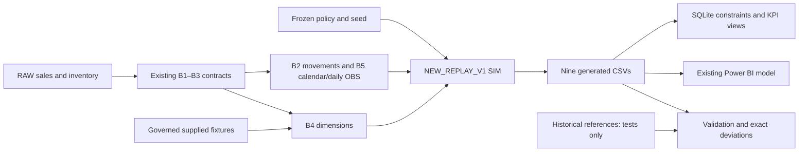

# Enterprise Retail Warehouse & Inventory Intelligence

A reproducible Python and SQLite analytical pipeline with an existing eight-page Power BI report. It separates observed demand and customer returns from simulated stock, service and supplier execution.

**Status: PARTIAL_REPRODUCIBILITY.** Observed transformations and all five dimensions reproduce the private historical references. The new, documented `NEW_REPLAY_V1` simulation runs and balances, but does **not** reproduce the historical V2 simulation. Power BI configuration has passed static checks; Desktop refresh and visual behavior are **not verified**. This release preserves the original historical report and datasets; running NEW_REPLAY_V1 produces a different scenario.

## Open the original historical Power BI report

The complete PBIP/PBIR/TMDL project, all eight pages, 112 visuals, 51 DAX measures, semantic relationships, eight screenshots and original report CSVs are included. **No simulation run is required to view the historical report.**

```powershell
git clone https://github.com/khaledzidan203-stack/enterprise-retail-warehouse-inventory-intelligence.git
cd enterprise-retail-warehouse-inventory-intelligence
python configure_powerbi.py
```

Close Power BI Desktop before configuration. The command verifies all nine historical CSV hashes and sets `DataRoot` to this checkout's **`data` folder**, not `build/`. Open `powerbi/Enterprise Retail Inventory Intelligence.pbip`, refresh, and use the existing report. The committed DataRoot is blank because an absolute path must be configured for each computer. Alternatively set that single parameter manually to `<checkout>/data`. See [Power BI setup](docs/powerbi_setup.md).

RAW is included unchanged from Mendeley Data under **CC BY 4.0**, with publisher hash verification. [Source attribution, license and download links](DATA_SOURCES.md).


## Optional reconstructed pipeline example

Requires Python 3.11 or newer; locally tested on CPython 3.13.15. Python's standard library supplies CSV, Decimal, testing and SQLite. No database server or third-party package is required.

The following optional commands execute the separately documented new scenario on fictional sample data. They do not replace the included historical CSVs:

```powershell
python -m venv .venv
.venv\Scripts\python -m pip install -r requirements.txt
.venv\Scripts\python run_pipeline.py --sample --output-dir build/public
.venv\Scripts\python run_pipeline.py --sample --output-dir build/repeat
.venv\Scripts\python validate.py --mode public --build build/public --compare-build build/repeat
```

On macOS/Linux use `.venv/bin/python` in place of `.venv\Scripts\python`. Publication CI checks required files and provenance without executing the analytical pipeline. The tests and optional reproducibility commands remain available.

Choose a **new** `build/<run-name>` for every run. Existing runs are rejected, never overwritten. When invoking scripts from another working directory, pass absolute script and output paths; output must still be under that checkout's `build/` directory.

The sample generator authors fictional identifiers, quantities, geography and supplier parameters without reading private data. Its numbers are a separate example baseline, not historical reproduction. The legacy public-mode validation lists the original-reference tests it omits; they are available through `--mode private` using the included historical files.

| Tested sample result | Value |
|---|---:|
| Store × Product / DC × Product rows | 6 / 6 |
| Daily Store rows / Supplier × DC rows | 656 / 4 |
| Closing Store / DC inventory | 24 / 54 units |
| Full-history returns | 40 units |
| Development holdout demand / fulfillment / shortage | 327 / 327 / 0 units |
| Holdout returns | 10 units |
| 84-day zero-demand stock / pairs | 8 units / 2 |

Each run produces nine CSVs in `build/<run>/data/`, `analytics.sqlite`, `execution.json`, and conservation, event and purchase-line evidence. Validation writes `validation.json`. A zero validation exit code means the executed analytical checks passed; it does not certify historical equivalence, licensing or Power BI runtime behavior. Historical mismatches exit **2**; implementation/test failures exit **1**.

## Architecture and business questions



Questions include where observed demand occurs, how a specified replenishment scenario would serve it, where simulated inventory has no recent demand, and how simulated supplier orders resolve. Shortage is modeled unmet demand, **not proven real-world lost sales**. Opportunity flags are exploratory, not approved purchasing decisions. The development holdout has been reused and is not independent production validation.

## Reconstructed execution on the included source data

RAW, governed fixtures, configuration and final V2 reference tables are included. Source attribution was verified before publication; see [data rights](docs/release_rights.md). The `--mode private` option retains its historical CLI name and runs the original source/reference tests; it does not imply these published inputs are confidential. These commands generate NEW_REPLAY_V1, not the historical simulation.

```powershell
python run_pipeline.py --input-dir data/raw --reference-dir data/synthetic --policy config/store_replenishment_policy_v2.json --output-dir build/private
python run_pipeline.py --input-dir data/raw --reference-dir data/synthetic --policy config/store_replenishment_policy_v2.json --output-dir build/private_repeat
python validate.py --mode private --build build/private --compare-build build/private_repeat --baseline-root .
```

The final command is expected to return **2**, with complete row/attribute exceptions in `evidence/historical_differences.csv`. It does not silently accept the simulation differences. Historical integrated V1 remains separate from the final V2 scenario exposed in the existing `analytics_v1` presentation files. [Reconciliation and methodology](docs/methodology.md) explain the exact limits.

## Power BI and release contents

The original PBIP/PBIR/TMDL model, 51 measures, 112 visuals, eight screenshots, original historical analytics, source RAW and governed configuration are included. One `DataRoot` parameter controls all nine imports. See [Power BI setup](docs/powerbi_setup.md). Local data caches, private dashboard generators, backups and temporary build outputs are excluded.

The existing screenshot set remains in `DASHBORD_SCREEN_SHOTS`: Index, Executive Overview, Store Inventory Intelligence, DC Inventory Intelligence, Sales & Stockout Performance, Supplier Execution Simulation, Inventory Opportunities (Exploratory), and Data Quality & Methodology. These depict the historical report, not the new simulation or sample.

The complete publication is explicitly listed in `release_manifest.json`; `.gitignore` excludes caches, backups and build artifacts. Run `python prepare_release.py --check` for essential file, hash, privacy and model checks only. Publication CI runs these checks without rebuilding analytics. The earlier 29-file synthetic-only candidate is not this release.

See the [data dictionary and SQL guide](docs/analytics_dictionary.md), [methodology and reconciliation](docs/methodology.md), and [rights and release boundary](docs/release_rights.md).
