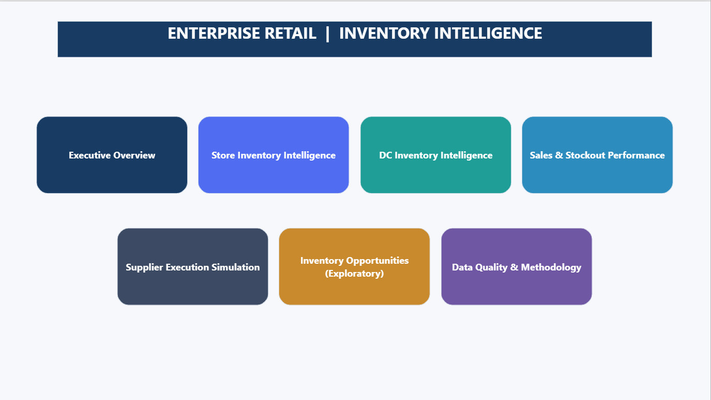

# Power BI Dashboard | Illustrated Eight-Page Guide

[Gallery](../README.md#power-bi-dashboard-gallery) · [Native PBIP](../powerbi/Enterprise%20Retail%20Inventory%20Intelligence.pbip) · [Open the report](powerbi_setup.md)

These are the **eight actual historical report screenshots**, not conceptual wireframes or screenshots of NEW_REPLAY_V1. The page summaries give the intended analytical scope; the current PBIP has not yet passed a fresh-machine Power BI Desktop runtime test.

## 1. INDEX

**Purpose:** launch the report from a single navigation hub. INDEX is for report access and provenance context; it is not an additional dataset.

## 2. Executive Overview

**Purpose:** present inventory across the modeled store/DC network and historical holdout service.

**Interpretation:** store/DC snapshot is **2026-04-24**; observed demand and historical simulated service relate to **2026-02-02–2026-04-24**. They have different grains and time scopes. Historical store stock **68,734**, DC stock **53,030**, observed holdout demand **30,000**, historical simulated shortage **637**.

## 3. Store Inventory Intelligence

**Purpose:** investigate **Store × Product** balances, in-transit inventory, open store replenishment requests, ABC/category concentration and modeled store coverage.

**Boundary:** original report universe **50,447 Store × Product pairs**. The region/city and DC mapping is synthetic; store physical inventory is SIM rather than a direct balance sheet extracted from ERP.

## 4. DC Inventory Intelligence

**Purpose:** inspect **DC × Product** stock, supplier on-order stock, store backlog and frozen-policy ROP/target comparisons.

**Boundary:** **9,304 DC × Product pairs**. Net position = on-hand + on-order − store backlog. Above simulated target does **not** independently establish corporate overstock or an approved return decision.

## 5. Sales & Stockout Performance

**Purpose:** show **Date × Store** observed gross demand and customer return inflow alongside modeled fulfillment/shortage.

**Boundary:** this fact does **not** have Product grain; SKU filters cannot legitimately resegment daily service. Aggregate unit service rate = total fulfilled / total demand, not average of daily percentage values. **SIM shortage is not observed lost sales.**

## 6. Supplier Execution Simulation

**Purpose:** cumulative modeled Supplier × DC purchasing, receipts, cancellations and open orders across **120 cohorts**.

**Boundary:** this is **not** an observed supplier performance dataset and does not support a per-day filter. Received-to-ordered quantity ratio is **not** independently measured OTIF.

## 7. Inventory Opportunities (Exploratory)

**Purpose:** diagnose zero-positive-demand items over trailing 28/56/84-day windows.

**Boundary:** zero demand uses **OBS** sales, on-hand units use historical **SIM** inventory. At 84 days: **45,021** modeled stock units across **31,776** historical Store × Product pairs with no positive sales. These are **exploratory screens**, not authorized markdown, transfer, overstock or supplier-return instructions.

## 8. Data Quality & Methodology

**Purpose:** explain analytical grain, source integrity, observed vs modeled metrics, snapshot/holdout boundaries and limitations.

**Further verification:** [Data dictionary](analytics_dictionary.md), [methodology](methodology.md) and [evidence map](PROJECT_EVIDENCE_MAP.md).

---

**To open the native report**, with Power BI Desktop closed run `python configure_powerbi.py` and open the PBIP. This points the original report to the included historical tables. It does not reconstruct the old simulation or prove Desktop refresh has succeeded.
