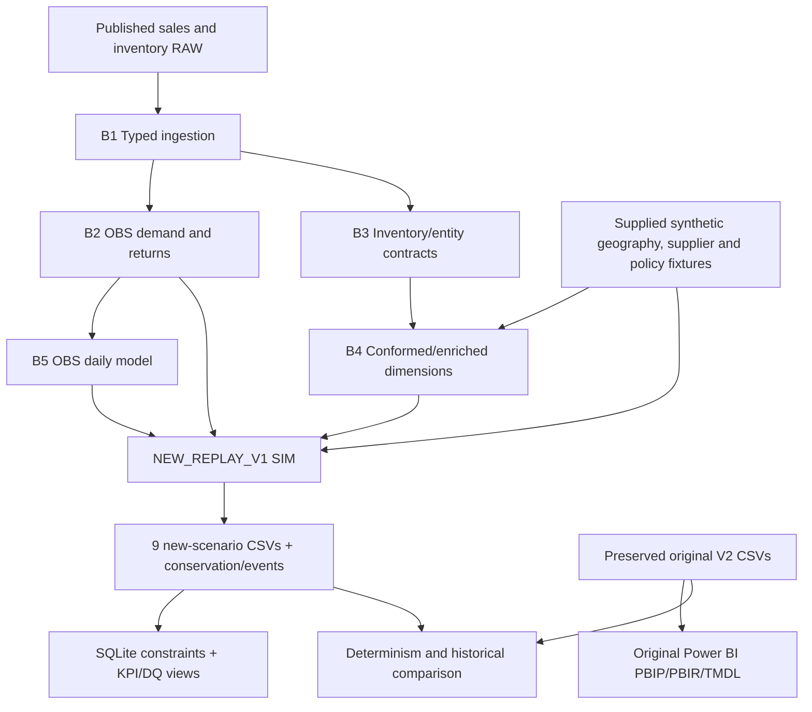

# Technical Walkthrough | Data to SQL and Power BI

[Project index](PROJECT_INDEX.md) · [Data dictionary](analytics_dictionary.md) · [Methodology](methodology.md)

## Two valid but different execution paths

**A. Historical report:** the original final V2 analytical CSVs in `data/analytics_v1/` and `data/powerbi_model_v1/` are shipped with the full PBIP/PBIR/TMDL project. They allow a reviewer to examine the **preserved** report without rerunning the lost historical simulator.

**B. Reconstructed analytical engine:** source RAW + explicitly supplied synthetic/policy inputs → OBS transformations → NEW_REPLAY_V1 → new CSVs, SQLite and tests. It is reproducible, but **not numerically identical** to the original V2 simulation.



## Canonical Python modules

| Module | What it implements | Principal contract |
|:---|:---|:---|
| [ingestion.py](../src/python/ingestion.py) | RAW normalization, types, source identities | Source signed quantities and open intervals retained |
| [observed_movements.py](../src/python/observed_movements.py) | Date × Store × Product OBS movements | 124,542 demand / 7,547 return units full history |
| [inventory_entities.py](../src/python/inventory_entities.py) | Source Store × Product union and interval profiling | 63,556 pairs, negatives/sentinels not silently repaired |
| [reference_dimensions.py](../src/python/reference_dimensions.py) | OBS entities + supplied SIM geography, ABC and supplier/DC profiles | 5 analytical dimensions |
| [observed_daily_model.py](../src/python/observed_daily_model.py) | 328 calendar dates and Date × Store demand/returns | 12,706 observed daily keys |
| [simulation.py](../src/python/simulation.py) | New stock, transfers, receipts, supplier events, shortage | Explicit SIM event order/assumptions |
| [pipeline.py](../src/python/pipeline.py) | Deterministic orchestration and isolated exports | New run directory, stable output schemas |
| [sql_model.py](../src/python/sql_model.py) | Import and reconcile SQLite projections | Keys/constraints/SQL row consistency |
| [validation.py](../src/python/validation.py) | Arithmetic, FK, grain, repeat hashes and historical comparator | Report all differences instead of forcing agreement |

The nine output CSV contracts, null semantics, event equations and SQL views are in [analytics_dictionary.md](analytics_dictionary.md).

## Open the original historical Power BI report

**Requirements:** Windows with compatible Power BI Desktop; Python 3.11+ for convenience script.

```powershell
git clone https://github.com/khaledzidan203-stack/enterprise-retail-warehouse-inventory-intelligence.git
cd enterprise-retail-warehouse-inventory-intelligence
python configure_powerbi.py --check
# Close Power BI Desktop, then:
python configure_powerbi.py
```

Open [Enterprise Retail Inventory Intelligence.pbip](../powerbi/Enterprise%20Retail%20Inventory%20Intelligence.pbip) and refresh. `DataRoot` points to the cloned repository's historical `data` directory. **No simulation rerun is necessary.** The Power BI metadata has passed static checks; actual Desktop refresh/visual behavior remains **NOT VERIFIED**.

## Run Python / SQLite on reproducible fictional data

**Requirements:** Python 3.11+ standard library only. Fresh output paths are mandatory.

```powershell
python run_pipeline.py --sample --output-dir build/demo_a
python run_pipeline.py --sample --output-dir build/demo_b
python validate.py --mode public --build build/demo_a --compare-build build/demo_b
```

Each execution creates nine generated CSVs, `analytics.sqlite`, `execution.json` and event/stock/purchase controls. The validator checks keys, FK integrity, quantities, store/DC stock conservation, supplier equation **ordered = received + cancelled + open**, DQ SQL views, and repeat-run outputs.

Run original RAW with NEW_REPLAY_V1 (historical comparison expected to diverge):

```powershell
python run_pipeline.py --input-dir data/raw --reference-dir data/synthetic --policy config/store_replenishment_policy_v2.json --output-dir build/new_a
python run_pipeline.py --input-dir data/raw --reference-dir data/synthetic --policy config/store_replenishment_policy_v2.json --output-dir build/new_b
python validate.py --mode private --build build/new_a --compare-build build/new_b --baseline-root .
```

The last command is expected to exit **2** for historical SIM mismatch, recording differences. Exit **1** is a validation execution failure, and **0** denotes a passing applicable validation. Legacy `--mode private` names the historical-reference path, not private company data.

## SQL implementation

[analytics.sql](../src/sql/analytics.sql) defines executable SQLite analytical tables and PK/FK/CHECK contracts. Its views include `ServiceKPI`, `HoldoutKPI`, `InventoryKPI` and `DQFailures`. Inventory snapshots cannot be summed as if each row were a transaction; Date × Store service has no Product key; supplier execution is cumulative Supplier × DC, not a dated line-by-line observed supplier KPI.

## Why exact historical reproduction is not claimed

The source original simulator's stock initialization, future-sale launch/prestaging, DC/store allocation and random-event schedule are not fully available. NEW_REPLAY_V1 has explicit replacement rules, different historical balances/shortage, and keeps inventory-only pairs. It never uses downstream report CSVs as production simulation inputs.

[Methodology and complete differences](methodology.md) · [Evidence map](PROJECT_EVIDENCE_MAP.md) · [Release validation](FINAL_RELEASE_VALIDATION.md).
